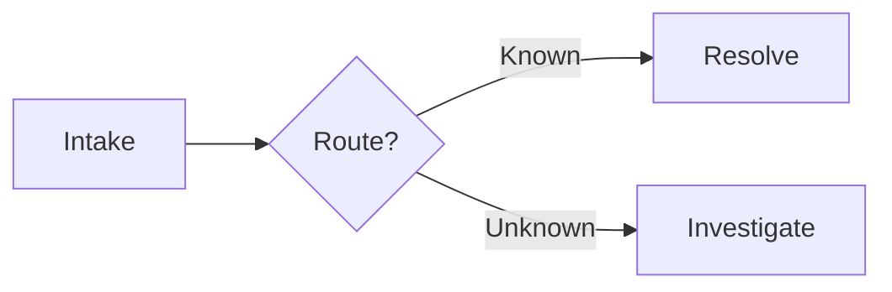

# Mermaid Style Guide

## Flowcharts

Use `flowchart LR` for pipelines and systems, `flowchart TD` for procedures and decision trees.

Prefer readable IDs and quoted labels:

## Sequence diagrams

Keep participants ordered by the normal interaction path. Use notes only for facts that change how the sequence is interpreted.

## ER diagrams

Model only entities needed for the question. Show cardinality explicitly and avoid turning the diagram into a full schema dump.

## Styling

Prefer semantic clarity over theme-specific colors. When color is needed, use a small palette and ensure labels remain readable in light and dark viewing contexts.
