# Agentic Governance & Intelligence Platform
## Reusable Control-Plane Primitives for Building Enterprise AI That Can't Hallucinate, Can't Run Unbounded, and Can't Bypass Controls

[](#enterprise-engineering-invariants)
[](#2-bounded-socratic-iteration-cost--latency-ceilings)
[](https://github.com/Siamese001/decision-intelligence-engine)

---

## The Enterprise AI Governance Gap

Most organizations deploy AI agents that work brilliantly in demos and fail catastrophically in production:

- **They hallucinate facts** — generating plausible-sounding commitments, metrics, and attributions that never occurred, then writing them to authoritative systems.
- **They run unbounded** — agent-to-agent correction loops spiral through hundreds of iterations, burning thousands of dollars in API costs before anyone notices.
- **They bypass governance** — naming conventions and prompt instructions are the first things violated under delivery pressure; nothing mechanically prevents a model from writing directly to production state.
- **They accumulate architectural debt** — without compile-time enforcement of layer boundaries, AI codebases devolve into unmaintainable coupling within months.

The failure cost isn't in the AI budget. It's in the downstream decisions made from hallucinated output, the engineering hours lost to debugging non-deterministic systems, and the compliance risk of ungoverned model emissions.

**This repository is a production-hardened control plane and governance toolkit for preventing all four failure modes** — with deterministic, machine-enforced invariants that scale from a single platform team to a 200-person AI engineering organization.

---

## Verified Platform Economics & Production Benchmarks

Every architectural control in this repository is backed by deterministic verification gates and measurable runtime economics:

| Dimension | Enforced Target / Ceiling | Verification Surface | Operational Impact |
| :--- | :--- | :--- | :--- |
| **Hallucination & Forbidden-Claims Rejection** | `100%` block rate on uncorroborated claims outside the 38-cluster Factual Assertion Graph (`C0.3`) | `apps_eval/` + Inbound/Outbound Prompt-Injection Airlock | Zero unverified metrics or fabricated attributions reach downstream state |
| **Tokenomics & Multi-Tier Caching ROI** | $\ge 2.5\times$ Pareto ROI with 3-turn hard-capped Socratic convergence loops | `python tools/cost_token_budget_auditor.py` | Eliminates runaway agent retry spend; guarantees predictable per-run unit economics |
| **Compile-Time Layer & Storage Isolation** | `0` cross-layer import violations (`L0`–`L6`); `0` direct persistence imports in domain services | `python tools/lint_architecture_boundaries.py` & `python tools/lint_layer_imports.py` | Prevents architectural drift mechanically at commit time (`<= 600` lines/module ceiling) |
| **Control-Plane Turn & Commit Verification** | `< 5s` full repository AST, schema, production-purity, and secret scan | `python tools/validate_turn_gates.py --mode all` & `python tools/verify_commit.py --all` | Continuous structural governability without slowing engineering velocity |

---

## Portfolio Architecture

This repository provides the **reusable agentic control-plane primitives** deployed in production in the [NEE Decision Intelligence Engine](https://github.com/Siamese001/decision-intelligence-engine).

```mermaid
flowchart LR
    subgraph Toolkit["THIS REPO: Governed Agentic Control Plane"]
        direction TB
        A["Factual Assertion Graph\n(Hallucination Prevention)"] 
        B["Bounded Socratic Iteration\n(Cost & Latency Ceilings)"]
        C["Universal Write Gateway\n(Mutation Control)"]
        D["AST Layer Enforcement\n(Architectural Integrity)"]
        E["Multi-Judge Evaluation\n(Quality Calibration)"]
    end

    subgraph Application["COMPANION REPO: Decision Intelligence Engine"]
        direction TB
        F["Enterprise Meeting Ingestion"]
        G["Forensic Transcript Synthesis"]
        H["Knowledge Graph Mutations"]
        I["Executive Briefing Delivery"]
    end

    Toolkit -->|"Control-plane substrate deployed in"| Application
```



The Decision Intelligence Engine is the **flagship enterprise application**; this repository is the **underlying control-plane and governance substrate**.

---

## Enterprise Engineering Invariants

Engineering leadership demands **enforced guarantees**, not prompt-level promises. This codebase enforces four strict architectural invariants across compile time and runtime:

### 1. Factual Assertion Knowledge Graph (Hallucination Prevention)
- **Graph-Led Authority**: The control plane evaluates candidate claims against 38 curated multi-node factual evidence clusters. Every assertion must trace back to a verified source node before it can pass the write gateway.
- **Forbidden Claims Guard**: Output generators pass through deterministic assertion checkers that reject unverified metrics, unsupported attributions, or policy-forbidden claims *before* any payload reaches the write gateway.

### 2. Bounded Socratic Iteration (Cost & Latency Ceilings)
- **Deterministic Step Caps**: Agent-to-agent self-correction loops are hard-capped at bounded iterations (configurable per pipeline) to prevent runaway execution costs.
- **Fail-Closed Convergence**: If an agent fails to meet rubric thresholds within its allocated turn quota, the system falls back to a deterministic, pre-certified safe abstention rather than returning unverified model emissions.

```text
Turn 1: Agent generates candidate output → Judge scores 62/100 (below 80 threshold)
Turn 2: Agent receives structured rubric feedback → Revises → Judge scores 78/100 (still below)
Turn 3: Agent receives delta feedback → Revises → Judge scores 85/100 (passes) → Output committed

Alternate path (fail-closed):
Turn 3: Agent revises → Judge scores 74/100 (still below after final turn)
→ System emits pre-certified safe fallback with explicit "convergence_failed" diagnostic
→ Zero unverified content reaches downstream consumers
```

### 3. Universal Write Gateway (UWG)
- **Single-Door Commit**: No agent or domain service can directly import concrete persistence drivers (`sqlite3`, filesystem stores) or mutate external state.
- **Atomic Admission**: State mutations must be proposed as typed payloads, evaluated by runtime exit gates, and committed through the Universal Write Gateway with cryptographic provenance seals.

### 4. Strict Layer Separation (Compile-Time Drift Elimination)
- **AST Dependency Graph**: Static analyzers (`tools/lint_layer_imports.py`, `tools/lint_architecture_boundaries.py`) map every module import, function fanout, and cross-layer call to reject boundary violations at commit time.
- **Clean Boundaries**: Strict separation across Reasoning (`L1`), Routing (`L0`), Context (`C0`), Orchestration (`L3`), Execution (`L2`), Safety/Exit (`L5`), Storage (`L4`), and Shadow Observability (`L6`).

---

## Platform Architecture & Subsystems

The repository separates **Core Platform Substrates** from **Reference Enterprise Workloads** that stress-test the control plane under strict grounding and policy constraints:

### Core Platform Substrates

| Subsystem | Role in the Control Plane | Key Technical Primitives |
| :--- | :--- | :--- |
| [`agents/`](agents/) & [`infrastructure/`](infrastructure/) | **Runtime Orchestration, Persistence & SDK Substrate**<br>Core orchestration services, protocol contracts, isolated persistence adapters, and cross-cutting runtime guardrails. | • Protocol-Driven Storage Isolation<br>• Cross-App Cryptographic Envelopes<br>• Provider-Neutral SDK Adapters |
| [`apps_eval/`](apps_eval/) | **Evaluation Lab & Judge Calibration Surface**<br>Offline grading, metric delta ratcheting, and multi-dimensional LLM judge calibration to prevent silent model regressions between releases. | • Multi-Judge Proof Panels<br>• Regression & Mutation Test Suites<br>• Deterministic CI Ratcheting |
| [`apps_model_telemetry/`](apps_model_telemetry/) | **Model Telemetry, Tokenomics & Observability Substrate**<br>Real-time execution telemetry, token consumption, latency profiling, and multi-tier caching efficiency across agent pipelines. | • OpenTelemetry Span Envelopes<br>• Token & Latency Profiling<br>• Multi-Tier Cache ROI Auditing |
| [`apps_research/`](apps_research/) | **Grounded Deep Research & Evidence Substrate**<br>Autonomous entity profiling and evidence synthesis bound to cryptographic handoff envelopes (`ResearchBriefEnvelope`). | • Inbound Query Injection Airlock<br>• Deterministic TTL & SHA-256 Envelopes<br>• Grounded Evidence Collector |

### Reference Enterprise Workloads

To prove the control plane on concrete, adversarial failure modes (hallucinated attributions and policy-violating external communications), two reference workloads are included:

| Reference Workload | Enterprise Capability Demonstrated | Control-Plane Primitives Exercised |
| :--- | :--- | :--- |
| **Verified Document & Dossier Synthesis** ([`resume_graph_engine/`](resume_graph_engine/) · `apps_rg`) | High-stakes structured document synthesis where every claim must trace to a verified node in a 38-cluster factual graph. | • 38-Cluster Factual Assertion Graph (`C0.3`)<br>• Dense BGE-M3 + BM25 Reciprocal Rank Fusion<br>• 6-Wave Offline Evaluation Surface (`G1`–`G6`) |
| **Policy-Gated External Messaging** ([`outreach_engine/`](outreach_engine/) · `apps_lic`) | Multi-touch external communication state machine enforcing strict inbound/outbound prompt-injection airlocks and forbidden-claims linting. | • Adversarial Briefing Injection Airlock<br>• Forbidden-Claims & Spam-Trigger Linting<br>• Deterministic Multi-Touch State Machine |

---

## Key Architectural Trade-offs

1. **Bounded vs. Unbounded Agent Iteration**: Capping Socratic correction loops at $N$ iterations trades unbounded exploration for predictable unit cost and a guaranteed safety floor.
2. **AST-Based vs. Convention-Based Layer Enforcement**: Static AST boundary linters break the build immediately when a domain service imports a concrete storage driver or violates layer hierarchy (`L0`–`L6`).
3. **Multi-Judge vs. Single-Judge Evaluation**: Multi-judge panels with inter-judge agreement calibration eliminate single-model grading variance before promoting pipeline changes.
4. **Fail-Closed Abstention vs. Best-Effort Emission**: When grounding or rubric thresholds fail after bounded retries, emitting a typed abstention diagnostic preserves downstream system trust.

---

## Quickstart & Executable Proofs

### Prerequisites
- Python 3.11+ (tested on 3.11 and 3.12)
- Git

### 1. Clone & Environment Setup
```bash
git clone https://github.com/Siamese001/agents.git
cd agents

python -m venv .venv
source .venv/bin/activate  # On Windows: .venv\Scripts\Activate.ps1
pip install -e .
```

### 2. Verify Compile-Time Governance & Architectural Boundaries
```bash
# Run pre-turn & post-turn mechanical governance gates
python tools/validate_turn_gates.py --mode all

# Run Tier 1 commit verification (AST budgets, layer imports, production purity, secrets)
python tools/verify_commit.py --all

# Verify domain storage isolation and sys.path purity
python tools/lint_architecture_boundaries.py
```

### 3. Verify Platform Tokenomics & Authoritative End-to-End Smoke Suite
```bash
# Audit 8-pillar tokenomics, multi-tier caching, and >= 2.5x Pareto ROI
python tools/cost_token_budget_auditor.py

# Run authoritative cross-subsystem smoke verification
python ops_scripts/run_e2e_authoritative_smoke.py
```

---

## Executive & Architecture Reading Guide

| Document | Audience | Focus |
|---|---|---|
| [**Executive Overview**](docs/EXECUTIVE_OVERVIEW.md) | C-Suite, Engineering Executives | Strategic thesis on runtime route authority, write controls, and enterprise risk management |
| [**Operating Model & Reliability Economics**](docs/RECRUITER_GUIDE.md) | Frontier Lab & Platform Leadership | Organizational scaling, unit economics, bounded autonomy, and multi-team governance |
| [**Runtime Control Plane Specification**](docs/RUNTIME_CONTROL_PLANE.md) | CTOs, Principal Architects | Detailed breakdown of the `U0 → L1 → L0 → C0 → L2 → Exit → UWG → L4/L6` control plane |
| [**Repository Governance Architecture**](docs/SVP_ENGINEERING_GOVERNANCE_README.md) | Platform Engineering Leaders | Machine-enforced turn gates, static AST boundary verification, and autonomous sidecar isolation |

---

## Author & Portfolio

**Amit Ayer**
*Enterprise AI Architecture · Governed Agentic Platforms · Decision Intelligence Systems*

- **Flagship Application**: [decision-intelligence-engine](https://github.com/Siamese001/decision-intelligence-engine) — Enterprise meeting intelligence platform deploying these governance primitives
- **GitHub**: [github.com/Siamese001](https://github.com/Siamese001)
