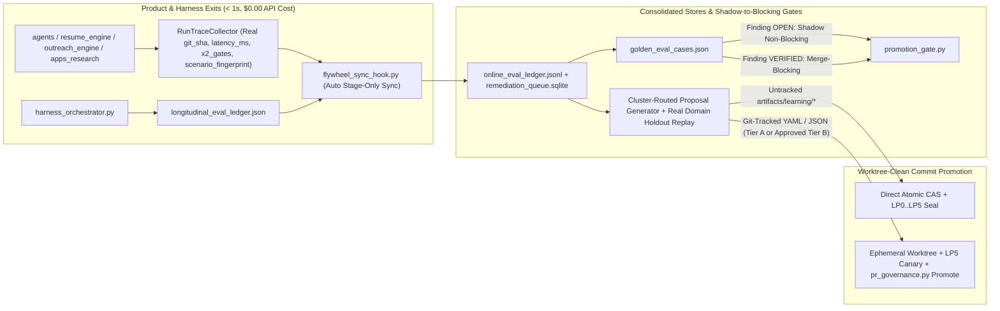

# Closed-Loop Evaluation Flywheel v2: Unified Sync, Scoped Resolution, Shadow-to-Blocking Golden Cases & Worktree-Clean Auto-Apply

| Wave | Description | Status |
| :--- | :--- | :--- |
| Wave 1 | Full-fidelity RunTrace provenance, scenario fingerprinting, standalone Outreach CLI wiring, and scoped failure resolution | COMPLETE |
| Wave 2 | Unified `<1s` post-run flywheel sync hook and live `longitudinal_eval_ledger.json` wiring | COMPLETE |
| Wave 3 | Shadow-to-blocking `golden_eval_cases.json` promotion and capability-to-regression graduation bridge | COMPLETE |
| Wave 4 | Cluster-routed calibration proposal synthesizer, `priors.yaml` initialization, and real domain shadow replay | COMPLETE |
| Wave 5 | Ephemeral git worktree governed commit promoter for git-tracked Tier A and approved Tier B updates | COMPLETE |
| Wave 6 | Domain eval shield pinning, automation prompt alignment, end-to-end fault-injection suite, and governed merge | COMPLETE |

## Goal & Forensic Root-Cause Findings

Auditing the live `agents` evaluation flywheel across [eval_flywheel.py](file:///Users/amitayer/Git/agents/agents/observability/eval_flywheel.py), [run_eval_flywheel_cycle.py](file:///Users/amitayer/Git/agents/tools/run_eval_flywheel_cycle.py), [online_eval_ledger.jsonl](file:///Users/amitayer/Git/agents/artifacts/learning/online_eval_ledger.jsonl), [remediation_queue.sqlite](file:///Users/amitayer/Git/agents/artifacts/learning/remediation_queue.sqlite), and [learning_ledger.sqlite](file:///Users/amitayer/Git/agents/artifacts/learning/learning_ledger.sqlite) revealed **five directly observed structural gaps** in the core platform flywheel loop (keeping Resume planted-defect traps separate in [rg-confidence-traps-blind-judges-e7b31a.md](file:///Users/amitayer/Git/agents/plans/rg-confidence-traps-blind-judges-e7b31a.md)):

1. **Two Disconnected Flywheel Loops & Dead Outputs**: `EvalFlywheelEngine` ([eval_flywheel.py](file:///Users/amitayer/Git/agents/agents/observability/eval_flywheel.py)) updates `judge_calibration_history.json` on product runs (`11/24/2026`), whereas `run_eval_flywheel_cycle` ([run_eval_flywheel_cycle.py](file:///Users/amitayer/Git/agents/tools/run_eval_flywheel_cycle.py)) only runs manually (`last run 11/22/2026 01:42Z`). Furthermore, [harness_orchestrator.py](file:///Users/amitayer/Git/agents/apps_eval/harness_orchestrator.py) never appends to `longitudinal_eval_ledger.json`, and the 11 promoted real-failure cases in [golden_eval_cases.json](file:///Users/amitayer/Git/agents/artifacts/learning/golden_eval_cases.json) sit unexecuted during CI promotion checks.
2. **Premature Engine-Wide Failure Resolution**: In [eval_flywheel.py](file:///Users/amitayer/Git/agents/agents/observability/eval_flywheel.py#L469-L479), any single passing product run (`score >= 0.80`, including an offline smoke run or an unrelated job description) marks **every** open failure signature in `feedback_learning.sqlite` and **every** `PENDING_REVIEW` triage packet for that `app_id` as `RESOLVED`.
3. **Hollow Post-Run Trace Provenance & Standalone CLI Blind Spots**: All 24 rows in [online_eval_ledger.jsonl](file:///Users/amitayer/Git/agents/artifacts/learning/online_eval_ledger.jsonl) carry `"git_sha": "0000000000000000000000000000000000000000"`, `"latency_ms": 0.0`, and empty `x2_gates`, while standalone `python -m outreach_engine` ([parser_and_run.py](file:///Users/amitayer/Git/agents/outreach_engine/src/apps_lic/cli_subcommands/parser_and_run.py)) omits `emit_post_run_trace_safe` completely.
4. **Hardcoded Calibration Stub & Missing Priors File**: [proposal_generator.py](file:///Users/amitayer/Git/agents/agents/learning/proposal_generator.py#L81-L90) routes every `TRACK_1_CALIBRATION` cluster to one hardcoded key (`v12_routing.classifier_surface_threshold`), [flywheel_hitl_dispatcher.py](file:///Users/amitayer/Git/agents/agents/learning/flywheel_hitl_dispatcher.py#L654-L657) uses a synthetic `40.0ms` heuristic shadow runner, and `config/prompt_governance/priors.yaml` does not exist on disk (`applied_changes: 0` in `learning_ledger.sqlite`).
5. **Root Working-Tree Dirtiness Risk on Git-Tracked Tier A/B Commits**: [commit_engine.py](file:///Users/amitayer/Git/agents/agents/learning/commit_engine.py#L125-L129) writes directly to `repo_root / target_path`, which dirties the primary `main` working tree when mutating git-tracked files (`config/routing_calibration.yaml`, `apps_eval/suites/pinned_fix_regressions.json`, `config/prompt_governance/priors.yaml`) and conflicts with [git-worktree-governance.md](file:///Users/amitayer/Git/agents/.agents/rules/git-worktree-governance.md).



## Operator Decisions Locked In (`/grill-me` Alignment)

> [!IMPORTANT]
> 1. **Modular Core Scope**: Focus strictly on the core platform flywheel loop (`agents/observability/`, `agents/learning/`, `apps_eval/`, CLI trace seams, and `tools/`), keeping Resume planted-defect traps separate in [rg-confidence-traps-blind-judges-e7b31a.md](file:///Users/amitayer/Git/agents/plans/rg-confidence-traps-blind-judges-e7b31a.md).
> 2. **Shadow-to-Blocking Golden Cases**: Run promoted `golden_eval_cases.json` items in non-blocking shadow mode while their linked finding is open, and flip them automatically to merge-blocking in `promotion_gate.py` once the linked finding reaches `VERIFIED`.
> 3. **Worktree-Governed Tracked File Commits**: Land git-tracked Tier A and approved Tier B updates (`config/routing_calibration.yaml`, `config/prompt_governance/priors.yaml`, `apps_eval/suites/pinned_fix_regressions.json`) via an ephemeral isolated git worktree and `tools/pr_governance.py`, keeping primary `main` clean.
> 4. **Fast Post-Run Auto-Sync (`$0.00`)**: Trigger the zero-API-cost grading, consolidation, golden-case promotion, and longitudinal sync automatically after every completed product run and eval harness run (`< 1s`, staging proposals without inline git mutations during product CLI runs).

> [!WARNING]
> **Merge-Blocking Verification Contract**: Once Wave 3 lands, transitioning a finding in `remediation_queue.sqlite` to `VERIFIED` immediately activates its promoted cases in `golden_eval_cases.json` as hard regression checks inside `verify_promotion_evidence()`. Any regression on a previously verified real failure will return `exit_code = 2` (`REGRESSION`).

## Architectural Defense & Pipeline Contract Alignment

- **Strict Storage & Subsystem Isolation (`lint_architecture_boundaries.py`, `ssot_boundary_auditor.py`)**:
  - `apps_eval/` modules (`golden_suite_runner.py`, `harness_orchestrator.py`, `promotion_gate.py`, `online_grader.py`, `holdout_replay.py`) remain 100% pure JSON/filesystem with zero `sqlite3` imports and zero direct `apps_rg` / `apps_lic` imports; finding statuses are read from the exported pure-JSON `remediation_queue_snapshot.json`.
  - Upstream C0 retrieval/allocation (`runtime/c0/`, `quad_graph_retriever.py`, `resume_graph_allocation.py`), `outreach_engine` briefing resolution (`briefing_resolver.py`, `mission_loader.py`), and downstream X2/X3 domain validators (`cross_section_x2.py`, `domain/validators.py`) stay structurally unchanged; CLI exit wrappers in `resume_engine/cli.py`, `outreach_engine/src/apps_lic/cli_subcommands/`, `agents/cli.py`, and `apps_research/integrations/governed_research_run.py` observe completed run artifacts fail-safely without coupling engines to each other.
- **Zero Commercial API Spend**: Every trace grade, shadow replay, longitudinal check, and ephemeral worktree verification runs locally at `$0.00` marginal API cost.

---

## Wave 1: Full-Fidelity RunTrace Provenance, Scenario Fingerprinting & Scoped Failure Resolution

### Objective & Scope
Eliminate all-zero `git_sha`, `0.0ms` `latency_ms`, and empty `x2_gates` records in `run_traces.jsonl` / `online_eval_ledger.jsonl`, wire standalone `outreach_engine` CLI runs into `RunTraceCollector`, and fix the over-broad engine-wide resolution defect in `EvalFlywheelEngine.ingest_product_run()` so a passing run only resolves failure signatures and triage packets matching the same scenario/constraint fingerprint (and never allows `--offline-smoke` or `--demo` runs to clear real failures).

### Milestones & Deliverables
- [MODIFY] `agents/observability/trace_collector.py`: Auto-resolve cached `git rev-parse HEAD` (`subprocess.run(..., shell=False, timeout=5)`) and active `config_digest` (SHA-256 over `config/routing_calibration.yaml` + `config/provider_profiles.yaml`) inside `build_run_trace()` whenever caller defaults (`"0" * 40` / `"0" * 64`) are passed; compute deterministic `scenario_fingerprint` from `(app_id, company, role, channel_or_profile, smoke_mode)`.
- [MODIFY] `agents/observability/eval_flywheel.py`: Add `scenario_fingerprint: str = ""` and `is_smoke_or_demo: bool = False` parameters to `ingest_product_run()` and `resolve_triage_candidates()`, restricting auto-resolution in `feedback_learning.sqlite` and `data/eval/triage/` strictly to matching scenario fingerprints or explicit `failure_mode_filter` matches (blocking smoke/demo runs from resolving production failure signatures).
- [MODIFY] `resume_engine/cli.py`: Pass measured wall-clock `latency_ms`, per-section `x2_gates` extracted from `run_dir`, `scenario_fingerprint`, and `is_smoke_or_demo` into `emit_post_run_trace_safe()` and `EvalFlywheelEngine().ingest_product_run()`.
- [MODIFY] `outreach_engine/src/apps_lic/cli_subcommands/parser_and_run.py` & `outreach_engine/src/apps_lic/cli_subcommands/eval_show_validate.py`: Emit post-run `RunTrace` with `latency_ms`, validator `x2_gates`, `x3_disposition`, and `scenario_fingerprint` on standalone `python -m outreach_engine run` and `eval` invocations (guarded when `PYTEST_CURRENT_TEST` is set unless `AGENTS_TRACE_IN_PYTEST=1`).
- [MODIFY] `agents/cli.py` & `apps_research/integrations/governed_research_run.py`: Populate `latency_ms`, `gate_outcomes["x2_gates"]`, and `scenario_fingerprint` on unified CLI and research runs.
- [NEW] `tests/unit/test_trace_provenance_and_scoped_resolution.py`: Unit and counterfactual tests verifying live `git_sha`/`config_digest`/`latency_ms`/`x2_gates` population, standalone `outreach_engine` trace emission, and strict scenario-scoped failure resolution.

### Acceptance Criteria
- `build_run_trace()` emits a 40-hex non-zero `git_sha` and 64-hex non-zero `config_digest` in `< 20ms` when called with default arguments inside the git repository.
- Standalone `outreach_engine run --demo --offline-smoke` (with `AGENTS_TRACE_IN_PYTEST=1` onto an isolated `traces_path`) emits a valid `OnlineEvalRecord`-compatible `RunTrace` with `latency_ms > 0.0` and non-empty `gate_outcomes`.
- In `EvalFlywheelEngine.ingest_product_run()`, a passing Truist run or `--offline-smoke` run leaves an open Anthropic failure signature and `PENDING_REVIEW` triage packet untouched (`status == "PENDING_REVIEW"`), whereas a passing non-smoke Anthropic run with matching `scenario_fingerprint` transitions only the Anthropic failure/packet to `RESOLVED`.

### Runtime Receipt & Completion Gate
- Run: `.venv/bin/python -m pytest tests/unit/test_trace_provenance_and_scoped_resolution.py -v --timeout=60 && .venv/bin/python tools/lint_architecture_boundaries.py`
- Input: Synthetic multi-scenario (`anthropic_partnerships` vs `truist_fde` vs `offline_smoke`) product run events and isolated `traces_path` CLI invocations.
- Expected: All unit tests pass, `lint_architecture_boundaries.py` exits `0`, zero `0000...` git SHAs or cross-scenario false resolutions.
- Verify independently: Inspect emitted `RunTrace` JSON lines in test temp dir to confirm 40-char real `git_sha`, `latency_ms > 0`, populated `x2_gates`, and `scenario_fingerprint`.
- Fail if: Any smoke or mismatched-scenario run resolves an unrelated failure signature, `git_sha` equals `"0" * 40`, or any domain storage boundary rule is violated.
- Record: `artifacts/eval_harness/receipts/wave1_trace_provenance_scoped_resolution_receipt.json`

---

## Wave 2: Unified Flywheel Sync Hook & Live Longitudinal Drift Ledger Wiring

### Objective & Scope
Bridge the gap between `EvalFlywheelEngine` and `run_eval_flywheel_cycle.py` by introducing a fast (`< 1s`, `$0.00` API cost) stage-only observer hook that runs automatically after every completed product run and unified eval harness run, and wire `harness_orchestrator.py` / `run_eval_flywheel_cycle.py` to populate `artifacts/learning/longitudinal_eval_ledger.json` so cumulative anchor-peak and rolling-window drift alerts work continuously on live runs.

### Milestones & Deliverables
- [NEW] `agents/observability/flywheel_sync_hook.py`: Expose fail-safe `sync_flywheel_after_run(*, repo_root, runtime_root, manifest_payload=None)` executing incremental `drain_new_traces` -> `backfill_online_grades` -> `consolidate_all_findings` -> `promote_golden_cases` -> longitudinal append -> `synthesize_proposals_from_clusters` (`auto_apply_tier_a=False` during inline product CLI exit; lock-protected via file lock so concurrent runs never contend).
- [MODIFY] `tools/run_eval_flywheel_cycle.py`: Add `record_manifest_to_longitudinal_ledger()` ingesting `evidence_manifest.json` (`suite_receipts`, `apps_lic_g5_g6_receipt`, active rubric SHA-256, and live `git_sha`) into `LongitudinalEvaluationTracker` at `output_root / "longitudinal_eval_ledger.json"` before running `detect_cumulative_merge_drift()` and `detect_rolling_window_drift()`.
- [MODIFY] `resume_engine/cli.py`, `outreach_engine/src/apps_lic/cli_subcommands/parser_and_run.py`, `agents/cli.py`, `agents/eval_flywheel_cli.py`, & `ops_scripts/ci/check_eval_harness_promotion_evidence.py`: Invoke `sync_flywheel_after_run()` automatically after completed non-pytest product runs and eval harness runs.
- [NEW] `tests/unit/test_unified_flywheel_sync_and_longitudinal_wiring.py`: Unit and integration tests verifying `< 1.0s` incremental post-run sync, automatic `online_eval_ledger.jsonl` + `remediation_queue_snapshot.json` refresh after product runs, and `DRIFT_ALERT` (`exit_code == 2`) when cumulative merge drift degrades `>= 0.03` from anchor peak.

### Acceptance Criteria
- Completing a non-pytest product or eval harness run automatically updates `online_eval_ledger.jsonl`, `remediation_queue.sqlite`, `remediation_queue_snapshot.json`, and `longitudinal_eval_ledger.json` in `< 1.0s` at `$0.00` API cost without mutating any git-tracked file.
- `LongitudinalEvaluationTracker` records suite scores and `G5/G6` calibration metrics on every harness run and triggers `exit_code == 2` (`DRIFT_ALERT`) in `run_eval_flywheel_cycle()` when rolling 3-of-5 drops or cumulative `-0.03` anchor-peak drift ("boiling frog" 4x `-0.008` merges) occur.

### Runtime Receipt & Completion Gate
- Run: `.venv/bin/python -m pytest tests/unit/test_unified_flywheel_sync_and_longitudinal_wiring.py -v --timeout=60`
- Input: Isolated runtime directory with sequential `RunTrace` emissions and 5 progressive `evidence_manifest.json` snapshots (`0.98 -> 0.972 -> 0.964 -> 0.956 -> 0.948`).
- Expected: Incremental sync completes in `< 1.0s`, `longitudinal_eval_ledger.json` records all 5 runs, and 5th run triggers `cumulative_anchor_peak` `DRIFT_ALERT` (`exit_code == 2`).
- Verify independently: Read `flywheel_cycle_receipt.json` and `longitudinal_eval_ledger.json` in test sandbox to confirm populated `entries` and `drift_alerts`.
- Fail if: Sync exceeds `1.0s` on incremental trace drain, mutates git-tracked files inline, or misses cumulative `-0.03` drift.
- Record: `artifacts/eval_harness/receipts/wave2_unified_sync_longitudinal_receipt.json`

---

## Wave 3: Golden-Case Shadow-to-Blocking Promotion & Capability Graduation Bridge

### Objective & Scope
Connect `artifacts/learning/golden_eval_cases.json` and `capability_graduation_state.json` into `apps_eval/harness_orchestrator.py`, `apps_eval/promotion_gate.py`, and `agents/learning/proposal_generator.py`: run promoted golden cases linked to open findings in **non-blocking shadow mode**, enforce golden cases linked to `VERIFIED` findings as **merge-blocking** regression gates, and synthesize `regression_case_pin` proposals when capability suites complete 10 consecutive clean runs.

### Milestones & Deliverables
- [NEW] `apps_eval/golden_suite_runner.py`: Pure JSON/filesystem module (`zero sqlite3 imports`) loading `golden_eval_cases.json` and `remediation_queue_snapshot.json`, Partitioning cases by linked cluster/finding status into `shadow_cases` (`OPEN`, `APPROVED`, `IN_PROGRESS`, `SNOOZED`) vs `blocking_cases` (`VERIFIED` or curated locked seeds), evaluating each case deterministically via ` EvalCase.unlabeled_view`, and emitting `golden_flywheel_receipt` (`shadow_pass_rate`, `blocking_pass_rate`, `blocking_failures`).
- [MODIFY] `apps_eval/harness_orchestrator.py`: Call `evaluate_golden_flywheel_suite()` during `run_unified_eval_harness()` and embed `golden_flywheel_receipt` inside `evidence_manifest.json`.
- [MODIFY] `apps_eval/promotion_gate.py`: Verify `golden_flywheel_receipt` in `verify_promotion_evidence()`: record `shadow_cases` metrics as non-blocking telemetry, and fail closed (`status = "REGRESSION"`, `exit_code = 2`) if any `VERIFIED` `blocking_cases` item fails (`blocking_failures > 0`).
- [MODIFY] `agents/observability/eval_flywheel.py` & `agents/learning/proposal_generator.py`: Read `graduation_ready_suites` from `capability_graduation_state.json` (`>= 10` consecutive passes with `stage == "capability"`) and synthesize a bounded Tier A `regression_case_pin` `ImprovementProposal` targeting `apps_eval/suites/pinned_fix_regressions.json`.
- [NEW] `tests/unit/test_golden_shadow_to_blocking_and_graduation.py`: Counterfactual tests proving open-finding golden failures do not block `verify_promotion_evidence()`, `VERIFIED`-finding golden regressions return `exit_code == 2` (`REGRESSION`), and 10-pass capability streaks emit `regression_case_pin` proposals.

### Acceptance Criteria
- `apps_eval/golden_suite_runner.py` contains zero `sqlite3` or `agents.persistence` imports (`lint_architecture_boundaries.py` passes).
- A failing golden case linked to an `OPEN` finding produces `PromotionGateResult(status="PASS", exit_code=0)` with shadow failure telemetry visible in `metrics["golden_flywheel"]`.
- Transitioning that finding to `VERIFIED` in `remediation_queue_snapshot.json` while the case still fails flips `verify_promotion_evidence()` to `PromotionGateResult(status="REGRESSION", exit_code=2)`.
- Reaching `consecutive_passes == 10` on a capability suite synthesizes a valid `regression_case_pin` `ImprovementProposal` with signed provenance.

### Runtime Receipt & Completion Gate
- Run: `.venv/bin/python -m pytest tests/unit/test_golden_shadow_to_blocking_and_graduation.py -v --timeout=60 && .venv/bin/python tools/lint_architecture_boundaries.py`
- Input: Hermetic `golden_eval_cases.json` + `remediation_queue_snapshot.json` fixtures toggling finding status `OPEN -> VERIFIED` and a 10-pass `capability_graduation_state.json`.
- Expected: `OPEN` shadow case exits `0`; `VERIFIED` regressed case exits `2` (`REGRESSION`); 10-pass suite emits `regression_case_pin` proposal; zero boundary violations.
- Verify independently: Inspect `PromotionGateResult.to_dict()` checks (`golden_flywheel_blocking`) and `regression_reasons`.
- Fail if: `OPEN` findings block unrelated merges, `VERIFIED` findings fail to block on regression, or `EvalCase.expected_contract` leaks into `unlabeled_view`.
- Record: `artifacts/eval_harness/receipts/wave3_golden_shadow_blocking_receipt.json`

---

## Wave 4: Cluster-Routed Calibration Synthesizer, Priors SSOT & Domain Shadow Replay

### Objective & Scope
Replace the single-key `v12_routing.classifier_surface_threshold` stub in `proposal_generator.py` and the synthetic `40.0ms` heuristic runner in `flywheel_hitl_dispatcher.py` with a deterministic root-cause-to-parameter router covering all 6 allowlisted parameters in `config/routing_calibration.yaml` plus Tier B `config/prompt_governance/priors.yaml`, backed by real deterministic domain threshold replay over `EvalCase.unlabeled_view`.

### Milestones & Deliverables
- [NEW] `config/prompt_governance/priors.yaml`: Initialize canonical Tier B YAML configuration (`schema_version: "1.0.0"`, `flywheel_priors: {}`) for diagnostic critique priors (`INV-NO-POST-LLM-PROSE-MUTATORS`).
- [MODIFY] `agents/learning/proposal_generator.py`: Replace hardcoded `v12_routing.classifier_surface_threshold` mapping with deterministic signal-to-parameter routing:
  - `latency_sla` / `loop_guard` -> `config/routing_calibration.yaml::v12_routing.loop_guard_efficiency_threshold` (Tier A)
  - `semantic_cache` -> `config/routing_calibration.yaml::semantic_cache.similarity_threshold` (Tier A)
  - `abstain` / `safe_abstain` -> `config/routing_calibration.yaml::abstain.default_threshold` (Tier A)
  - `escalate` / `r_casc` -> `config/routing_calibration.yaml::v12_routing.r_casc_escalation_threshold` (Tier A)
  - `semantic_match` / `r1b` -> `config/routing_calibration.yaml::v12_routing.r1b_semantic_match_threshold` (Tier A)
  - `classifier_surface` -> `config/routing_calibration.yaml::v12_routing.classifier_surface_threshold` (Tier A)
  - `correction:*` / `hitl_override:*` -> `config/prompt_governance/priors.yaml::flywheel_priors.<bucket>` (`prompt_prior`, `TIER_B_HITL_GATED`, `LANE_1`, diagnostic critique guidance only, rejecting any literal prose splice strings).
- [MODIFY] `agents/learning/flywheel_hitl_dispatcher.py` & `apps_eval/holdout_replay.py`: Replace `_default_calibration_runner` (`latency_ms: 40.0` stub) with `build_domain_calibration_replay_runner(proposal, repo_root)` evaluating real routing/abstain/loop-efficiency rules over `EvalCase.unlabeled_view` with measured `time.perf_counter()` latency and live `run_diff_scoped_eval_shield` pinned-regression status.
- [NEW] `tests/unit/test_cluster_routed_proposals_and_real_replay.py`: Unit tests covering all 6 Tier A routing parameters, Tier B `priors.yaml` proposals, literal-prose-splice rejection (`INV-NO-POST-LLM-PROSE-MUTATORS`), and real holdout replay pass/veto math.

### Acceptance Criteria
- Distinct `TRACK_1_CALIBRATION` clusters map deterministically to their corresponding bounded parameter in `config/routing_calibration.yaml` within `[min, max]` bounds from `auto_apply_policy.yaml`, while `operator_correction` and `hitl_override` clusters map to `TIER_B_HITL_GATED` `prompt_prior` entries in `config/prompt_governance/priors.yaml`.
- Any candidate `repair_hint` or `prompt_prior` containing literal prose injection markers is rejected fail-closed (`INV-NO-POST-LLM-PROSE-MUTATORS`).
- Shadow holdout replay executes real parameter evaluation against `unlabeled_view` with measured wall-clock latency (`zero hardcoded 40.0ms constants`).

### Runtime Receipt & Completion Gate
- Run: `.venv/bin/python -m pytest tests/unit/test_cluster_routed_proposals_and_real_replay.py -v --timeout=60 && .venv/bin/python tools/audit_multi_ssot_judge_gate_drift.py`
- Input: 7 synthetic `FailureCluster` objects spanning all 6 routing signals + operator correction signal, replayed against development and locked holdout `EvalCase` splits.
- Expected: 7/7 proposals map to exact target keys within SSOT bounds, `priors.yaml` exists and parses cleanly, and `audit_multi_ssot_judge_gate_drift.py` exits `0`.
- Verify independently: Inspect generated `ImprovementProposal` JSON payloads to confirm distinct `target_path`, `target_key`, `autonomy_tier`, and non-mocked `HoldoutReplayVerdict` metrics.
- Fail if: Two distinct calibration failure families collide onto hardcoded `classifier_surface_threshold`, `priors.yaml` is missing, or any `40.0` hardcoded mock latency remains in production code.
- Record: `artifacts/eval_harness/receipts/wave4_cluster_routed_calibration_receipt.json`

---

## Wave 5: Ephemeral Worktree Governed Auto-Commit Engine for Git-Tracked Targets

### Objective & Scope
Eliminate working-tree dirtiness on `main` when Tier A or approved Tier B commits target git-tracked files (`config/routing_calibration.yaml`, `config/prompt_governance/priors.yaml`, `apps_eval/suites/pinned_fix_regressions.json`) by executing tracked-file commits inside an ephemeral isolated git worktree (`.worktrees/flywheel_apply_<commit_id>`), running `LP5` canary + diff-scoped eval shield inside the worktree, promoting cleanly via `tools/pr_governance.py`, and pruning the worktree immediately.

### Milestones & Deliverables
- [NEW] `agents/learning/worktree_promoter.py`: Implement `is_git_tracked_target(repo_root, rel_path)` (`git -C <repo_root> ls-files --error-unmatch`) and `apply_and_promote_in_ephemeral_worktree(...)`:
  1. Create `.worktrees/flywheel_apply_<commit_id>` on branch `chore/flywheel-apply-<commit_id>` from `HEAD`.
  2. Apply CAS mutation via `commit_engine.py` targeting the worktree copy (primary `repo_root` stays untouched during staging).
  3. Run `LP5` canary evaluation and `tools/run_diff_scoped_eval_shield.py` inside the worktree.
  4. On pass: stage only `proposal.target_path`, commit on the worktree branch, promote to `main` via `tools/pr_governance.py` (or fast-forward governed merge in isolated test git repos), seal `LP0..LP5` Merkle root, and prune the worktree + branch in a `finally:` block.
  5. On canary or gate failure: abort, remove worktree + branch cleanly, record 7-day `POST_ROLLBACK_LOCK` in `learning_ledger.sqlite`, and leave `main` untouched.
- [MODIFY] `agents/learning/commit_engine.py`, `agents/learning/rollback_manager.py`, & `agents/learning/flywheel_hitl_dispatcher.py`: Route non-sandbox git-tracked Tier A and approved Tier B commits through `worktree_promoter.py`, while keeping untracked runtime stores (`artifacts/learning/*`) on fast in-place atomic CAS; support clean worktree-based revert commits in `rollback_manager.py` when rolling back a previously promoted git-tracked change.
- [MODIFY] `tools/audit_multi_ssot_judge_gate_drift.py`: Add parity check in `V6_FLYWHEEL_HITL_REMEDIATION_PARITY` verifying `config/prompt_governance/priors.yaml` presence and `worktree_promoter` callable wiring.
- [NEW] `tests/integration/test_worktree_governed_flywheel_commit.py`: Integration tests using a real initialized temporary git repository (`main` branch + `.githooks` / governed promotion) proving `git -C <repo_root> status --porcelain` stays empty before, during, and after both passing Tier A/B promotions and aborted/rolled-back canary failures.

### Acceptance Criteria
- Applying a Tier A (`config/routing_calibration.yaml`) or approved Tier B (`config/prompt_governance/priors.yaml`) update lands as a clean commit on `main` with `git -C <repo_root> status --porcelain == ""` and zero leftover `.worktrees/flywheel_apply_*` directories.
- If `LP5` canary or `run_diff_scoped_eval_shield` fails inside the ephemeral worktree, `main` `HEAD` and working tree remain 100% unchanged, the ephemeral worktree is pruned, and a 7-day anti-oscillation lock is recorded in `learning_ledger.sqlite`.
- Untracked runtime targets (`artifacts/learning/feedback_learning.sqlite`, `artifacts/learning/trajectory_exemplars.json`) continue committing directly via atomic CAS without spawning a git worktree.

### Runtime Receipt & Completion Gate
- Run: `.venv/bin/python -m pytest tests/integration/test_worktree_governed_flywheel_commit.py tests/unit/test_wave3_cas_canary_rollback_seal.py -v --timeout=60`
- Input: Temporary git repository on `main` with tracked `config/routing_calibration.yaml` and `config/prompt_governance/priors.yaml`, testing nominal Tier A, nominal approved Tier B, and fault-injected `LP5` canary degradation.
- Expected: Nominal commits advance `main` cleanly with `git status --porcelain == ""`, failed canary leaves `main` SHA unchanged and sets 7-day rollback lock, `0` leaked worktrees.
- Verify independently: Run `git -C <tmp_repo> worktree list` and `git -C <tmp_repo> log -n 3 --oneline` inside test assertions to confirm governed commit lineage and clean teardown.
- Fail if: Primary `repo_root` ever has dirty uncommitted tracked files after `dispatch_cycle_remediation()`, any ephemeral worktree leaks on exception, or `subprocess.run` lacks `timeout=`.
- Record: `artifacts/eval_harness/receipts/wave5_worktree_governed_commit_receipt.json`

---

## Wave 6: End-to-End Closed-Loop Verification, Shield Pinning & Governed Merge

### Objective & Scope
Pin all new flywheel v2 invariants into the permanent `< 10s` diff-scoped eval shield (`pinned_fix_regressions.json` / `domain_eval_checks.py`), update the on-demand flywheel assurance launcher (`agents_evals_flywheel_assurance_agent.md`), mirror this plan to `plans/eval-flywheel-v2-hardening-<6hex>.md`, pass full Tier 1 (`verify_commit.py`) and Tier 2 (`verify_main_readiness.py` `10/10` stages), and promote the feature branch to `main` via `tools/pr_governance.py`.

### Milestones & Deliverables
- [MODIFY] `tools/eval_shield_core/domain_eval_checks.py` & `apps_eval/suites/pinned_fix_regressions.json`: Expand `pin-eval-001-blind-judge-zero-priming-and-trajectory-loops` (`check_agents_eval_flywheel_domain`) with 3 unmocked counterfactual invariants:
  1. `scoped_resolution_preserves_untested_scenario_failures`
  2. `golden_verified_cases_block_promotion_while_open_shadow_runs`
  3. `online_trace_populates_real_git_sha_and_latency`
- [MODIFY] `automations/prompts/agents_evals_flywheel_assurance_agent.md`: Update Phase 1.5 and Phase 3 instructions to verify `longitudinal_eval_ledger.json`, `golden_flywheel_receipt` shadow/blocking status, and worktree-governed Tier A/B commits (`validate_sidecar_separation.py` parity preserved).
- [NEW] `tests/end_to_end/test_unified_eval_flywheel_v2_e2e.py`: Full closed-loop E2E test exercising product trace emission -> `<1s` auto-sync -> scenario-scoped failure retention -> shadow golden execution while `OPEN` -> `VERIFIED` transition -> merge-blocking regression catch -> cluster-routed Tier A proposal -> ephemeral worktree commit + `LP0..LP5` Merkle seal.
- [NEW] `plans/eval-flywheel-v2-hardening-9c4e2a.md`: Repository-tracked wave plan validated by `tools/validate_implementation_plan.py`.

### Acceptance Criteria
- `tools/run_diff_scoped_eval_shield.py --all` passes all 5 domains in `< 10.0s` per domain and fails closed under fault injection.
- `tools/validate_sidecar_separation.py --json`, `tools/audit_multi_ssot_judge_gate_drift.py`, `tools/verify_commit.py`, and `tools/verify_main_readiness.py` (`10/10` stages) all exit `0`.
- Feature worktree promotes cleanly onto `main` via `tools/pr_governance.py` and is pruned immediately post-merge.

### Runtime Receipt & Completion Gate
- Run: `.venv/bin/python -m pytest tests/end_to_end/test_unified_eval_flywheel_v2_e2e.py tests/end_to_end/test_flywheel_hitl_remediation_e2e.py tests/end_to_end/test_wave4_eval_flywheel_e2e_fault_injection.py -v --timeout=120 && .venv/bin/python tools/run_diff_scoped_eval_shield.py --all && .venv/bin/python tools/verify_main_readiness.py`
- Input: Full repository test suite, 5-domain unmocked eval shield, and isolated feature worktree branch `feat/eval-flywheel-v2-hardening`.
- Expected: All E2E tests pass, all 5 shield domains `PASS`, `10/10` readiness stages `PASS`, exit code `0`.
- Verify independently: Run `.venv/bin/python tools/audit_multi_ssot_judge_gate_drift.py` and `.venv/bin/python tools/validate_sidecar_separation.py --json` confirming `0` violations and clean `git status --porcelain`.
- Fail if: Any readiness stage fails, per-domain shield SLA exceeds `10.0s`, or any merged worktree/branch remains unpruned.
- Record: `artifacts/eval_harness/receipts/wave6_eval_flywheel_v2_closeout_receipt.json`

---

## Verification Plan

### Automated Tests
```bash
/Users/amitayer/Git/agents/.venv/bin/python tools/validate_implementation_plan.py plans/eval-flywheel-v2-hardening-9c4e2a.md
/Users/amitayer/Git/agents/.venv/bin/python -m pytest \
  tests/unit/test_trace_provenance_and_scoped_resolution.py \
  tests/unit/test_unified_flywheel_sync_and_longitudinal_wiring.py \
  tests/unit/test_golden_shadow_to_blocking_and_graduation.py \
  tests/unit/test_cluster_routed_proposals_and_real_replay.py \
  tests/integration/test_worktree_governed_flywheel_commit.py \
  tests/end_to_end/test_unified_eval_flywheel_v2_e2e.py \
  tests/end_to_end/test_flywheel_hitl_remediation_e2e.py \
  -v --timeout=120
/Users/amitayer/Git/agents/.venv/bin/python tools/run_diff_scoped_eval_shield.py --all
/Users/amitayer/Git/agents/.venv/bin/python tools/audit_multi_ssot_judge_gate_drift.py
/Users/amitayer/Git/agents/.venv/bin/python tools/verify_commit.py
/Users/amitayer/Git/agents/.venv/bin/python tools/verify_main_readiness.py
```

### Manual Verification
1. Inspect `artifacts/learning/flywheel_cycle_receipt.json` and `artifacts/learning/longitudinal_eval_ledger.json` after a sandbox cycle (`tools/run_eval_flywheel_cycle.py --sandbox`) to verify populated longitudinal entries, real git SHAs, and cluster-routed proposals.
2. Confirm `git status --porcelain` in `/Users/amitayer/Git/agents` remains empty before and after promotion.
